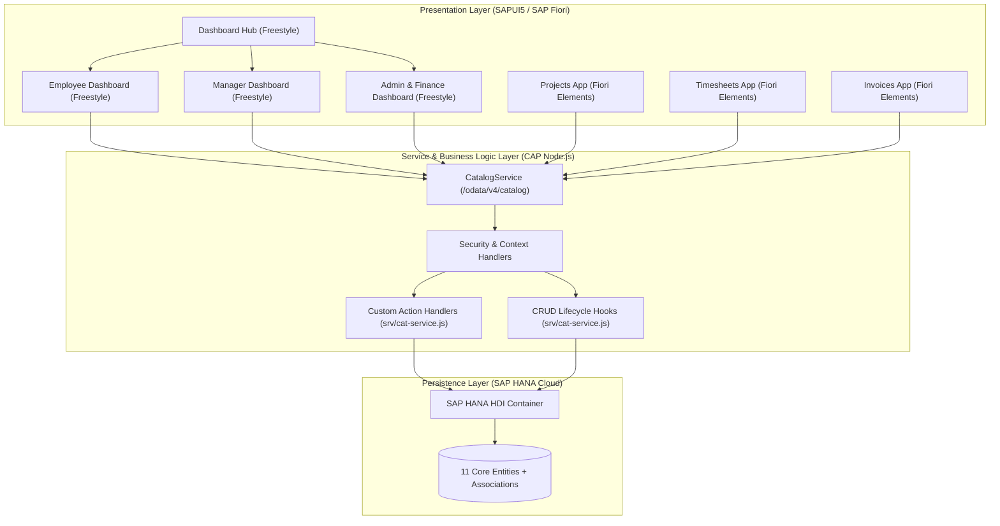
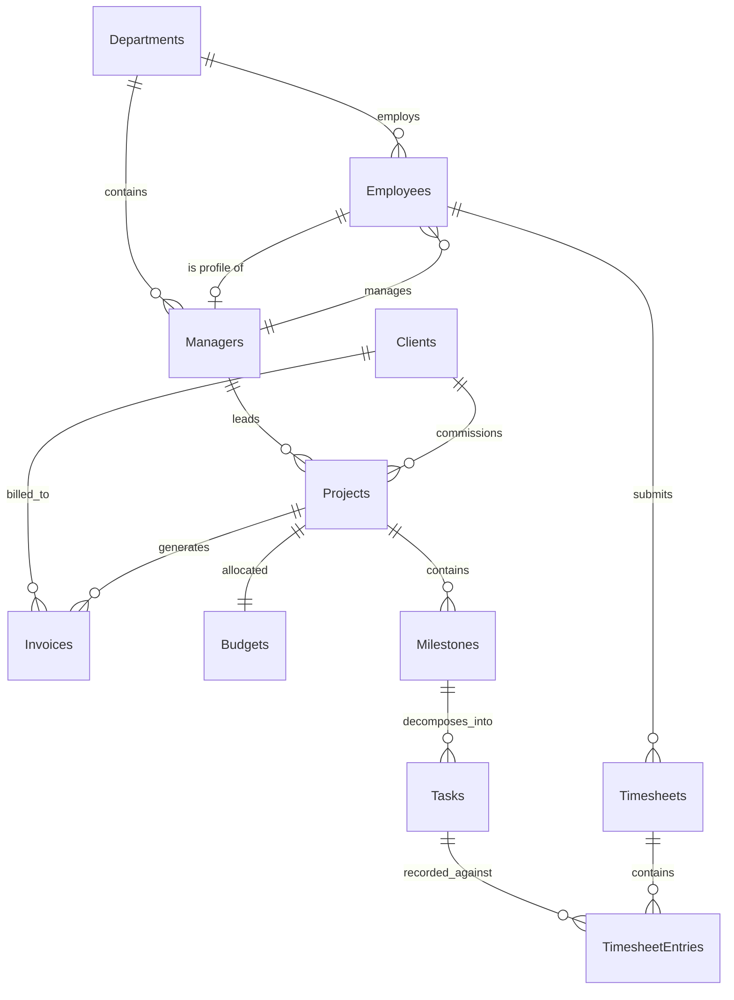
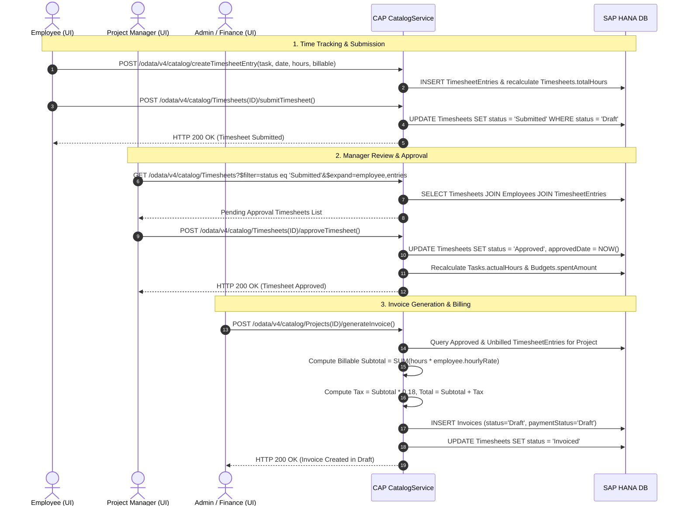
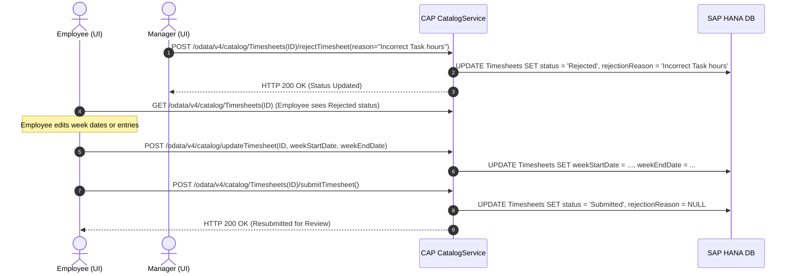
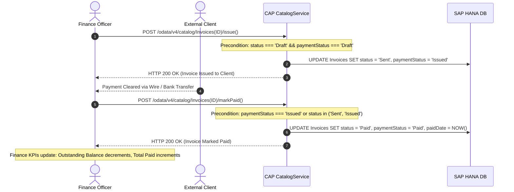
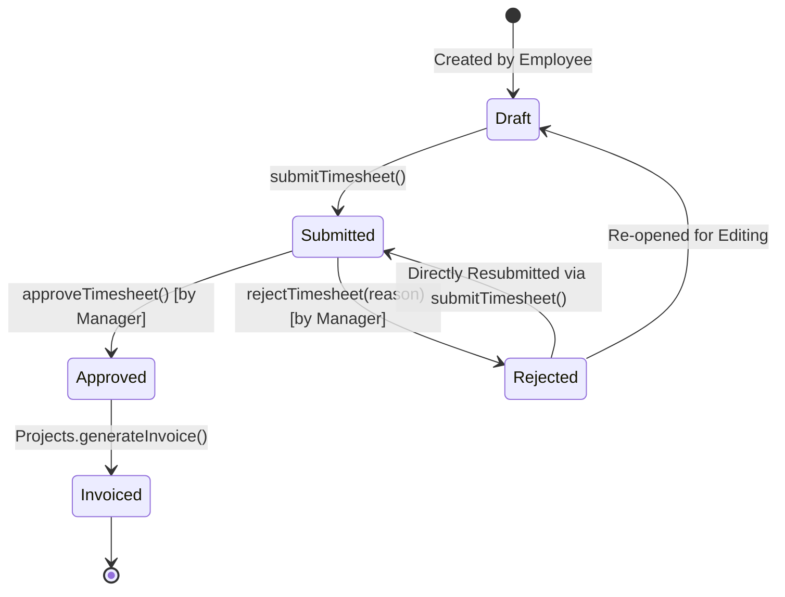
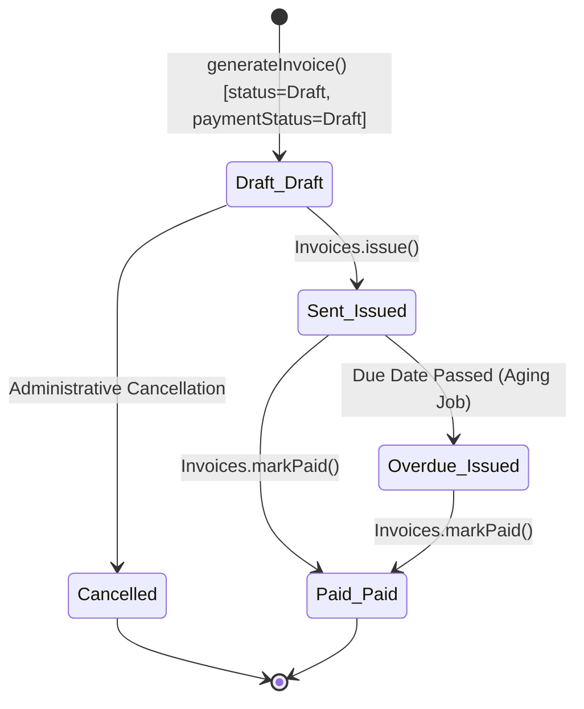

# EnterprisePSA: Architecture, Data Models & Business Workflows

**Version:** 1.0.0  
**Target Environment:** SAP Cloud Application Programming Model (Node.js) & SAP HANA Cloud  
**UI Framework:** SAPUI5 (Freestyle & Fiori Elements)  
**Protocol:** OData V4  

---

## 1. System Architecture Overview

EnterprisePSA is an enterprise-grade Professional Services Automation (PSA) platform engineered with the **SAP Cloud Application Programming Model (CAP)** on Node.js and backed by **SAP HANA Cloud**. The system provides end-to-end lifecycle management for client projects, resource staffing, milestone tracking, timesheet logging, manager approvals, financial billing, and accounts receivable.



### Architectural Key Characteristics:
1. **OData V4 Native**: All services are served via the OData V4 protocol at `/odata/v4/catalog`, enabling batch requests, complex expansions, and bound/unbound actions.
2. **Hybrid Presentation Tier**:
   - **Freestyle SAPUI5 Applications**: Tailored for high-interactivity personas (`app/dashboardhub`, `app/employeed`, `app/manager`, `app/admin`).
   - **SAP Fiori Elements Applications**: Standard metadata-driven List Report and Object Page applications (`app/project2`, `app/project3`, `app/project4`).
3. **Database Independence with HANA Optimization**: CDS definitions in `db/schema.cds` compile natively to SAP HANA HDI container table definitions and calculation views via `@cap-js/hana`.

---

## 2. Entity-Relationship Model (Domain Architecture)

EnterprisePSA consists of 11 tightly coupled domain entities organized across Organizational Structure, Project Delivery, Time Recording, and Financials.



### Entity Schema Summary

| Entity | Primary Key | Key Attributes | Core Associations |
| :--- | :--- | :--- | :--- |
| **`Departments`** | `ID` (UUID) | `name`, `code`, `description` | `employees`, `managers` |
| **`Employees`** | `ID` (UUID) | `firstName`, `lastName`, `email`, `role`, `hourlyRate`, `status` | `department`, `managerProfile`, `timesheets` |
| **`Managers`** | `ID` (UUID) | `department_ID`, `employee_ID`, `approvalLimit`, `level` | `department`, `employeeProfile`, `projects`, `directReports` |
| **`Clients`** | `ID` (UUID) | `name`, `industry`, `contactEmail`, `paymentTerms`, `creditRating` | `projects`, `invoices` |
| **`Projects`** | `ID` (UUID) | `name`, `code`, `startDate`, `endDate`, `status`, `currency` | `client`, `manager`, `budget`, `milestones`, `invoices` |
| **`Budgets`** | `ID` (UUID) | `totalAmount`, `spentAmount`, `remainingAmount`, `laborBudget` | `project` |
| **`Milestones`** | `ID` (UUID) | `name`, `targetDate`, `completionDate`, `status`, `weight` | `project`, `tasks` |
| **`Tasks`** | `ID` (UUID) | `title`, `estimatedHours`, `actualHours`, `billable`, `status` | `milestone`, `assignedTo`, `timesheetEntries` |
| **`Timesheets`** | `ID` (UUID) | `weekStartDate`, `weekEndDate`, `totalHours`, `status`, `rejectionReason` | `employee`, `entries` |
| **`TimesheetEntries`** | `ID` (UUID) | `workDate`, `hours`, `description`, `billable` | `timesheet`, `task` |
| **`Invoices`** | `ID` (UUID) | `invoiceNumber`, `subtotal`, `taxAmount`, `totalAmount`, `status`, `paymentStatus` | `project`, `client` |

---

## 3. End-to-End Business Workflows

### Workflow 1: Employee Timesheet Submission, Manager Approval & Billing Generation



---

### Workflow 2: Timesheet Rejection & Resubmission / Edit Cycle



---

### Workflow 3: Invoice Issuance, Payment Recording & Revenue Realization



---

## 4. Lifecycle State Machines

### 4.1 Timesheet Lifecycle State Machine



### 4.2 Invoice & Payment Dual-Status State Machine



---

## 5. Security Architecture & Production Hardening Roadmap

### 5.1 Current Architecture Analysis
- **Service Layer**: `srv/cat-service.cds` exposes `CatalogService` without restrictive `@requires` or `@restrict` annotations.
- **Authentication**: Local/development mock authentication currently active.
- **HDI Binding**: Secure HANA HDI credentials injected via Cloud Foundry environment variables (`VCAP_SERVICES`) in production and `.env` in local development.

### 5.2 Enterprise Hardening Recommendations

To achieve production compliance on SAP Business Technology Platform (BTP), execute the following configuration steps:

1. **Enable SAP Cloud Identity Services (XSUAA)**:
   Add `xs-security.json` defining standard PSA security scopes:
   - `PSA.Admin`: Full administrative and financial configuration.
   - `PSA.Manager`: Project management, team allocation, budget monitoring, and timesheet approvals.
   - `PSA.Employee`: Personal timesheet entry, task logging, and profile view.
   - `PSA.Finance`: Invoicing, accounts receivable, and payment processing.

2. **Decorate CDS Entities with Restrictions**:
   ```cds
   annotate CatalogService.Timesheets with @(restrict: [
       { grant: ['READ', 'CREATE', 'UPDATE'], to: 'Employee', where: 'employee.email = $user' },
       { grant: ['READ', 'approveTimesheet', 'rejectTimesheet'], to: 'Manager', where: 'employee.managerProfile.ID = $user.managerID' },
       { grant: '*', to: 'Admin' }
   ]);
   ```

3. **MTA Configuration Update**:
   Bind `enterprisepsa-srv` module to an `xsuaa` managed resource in `mta.yaml`.
